# Projeto - Cidadão Fácil

Projeto desenvolvido pela equipe NORTEIA para a disciplina de Front-end da FIAP, com o objetivo de aplicar os conhecimentos de HTML5 e CSS3 na construção de um site que explica serviços públicos em linguagem simples.

O site orienta a pessoa em cada etapa de um serviço público, com passo a passo e um assistente virtual para tirar dúvidas. O Cidadão Fácil não substitui os sistemas oficiais do governo: os pedidos são feitos nos canais oficiais.

## 🌐 Acesse

https://larissa-andrade-santos.github.io/cidadao-facil-frontend/

## Funcionalidades

- Início: apresentação do projeto, busca de serviços e serviços mais procurados.

- Serviços: serviços públicos organizados por categoria, com busca.

- Assistente: assistente virtual para perguntas em linguagem natural.

- Histórico: histórico opcional das consultas, que pode ser apagado a qualquer momento.

- Contato: formulário para falar com a equipe.

- FAQ: perguntas frequentes sobre a plataforma.

- Integrantes: apresentação dos desenvolvedores.

- Sobre: descrição do projeto, problema abordado, objetivo da solução e proposta desenvolvida pela equipe.

## Responsividade

Nesta etapa, o projeto recebeu melhorias de responsividade para proporcionar uma experiência adequada em diferentes tamanhos de tela.

Foram realizados ajustes em:

- Organização e adaptação dos elementos das páginas.

- Navegação e disposição dos links.

- Espaçamentos, fontes e tamanhos dos componentes.

- Distribuição de colunas e blocos de conteúdo.

- Campos de busca, botões e formulários.

- Blocos com fundo colorido, que ocupam a largura total da tela (`overflow-x: clip` para evitar rolagem horizontal).

## Breakpoints utilizados

Celular: até 480px.

Tablet: até 768px.

Desktop: acima de 768px.

## Tecnologias

- HTML5
- CSS3

## Estrutura

```
cidadao-facil/
├── index.html
├── servicos.html
├── assistente.html
├── etapas.html
├── historico.html
├── contato.html
├── faq.html
├── integrantes.html
├── sobre.html
├── CSS
│   └── style.css
├── imagens
│   └── beatriz.jpeg
│   └── giovanna.jpeg
│   └── guilherme.jpeg
│   └── henrique.jpeg
│   └── larissa.jpeg
└── README.md
```


## 👥 Integrantes

<div align="center">
  <table>
    <tr>
      <td align="center">
        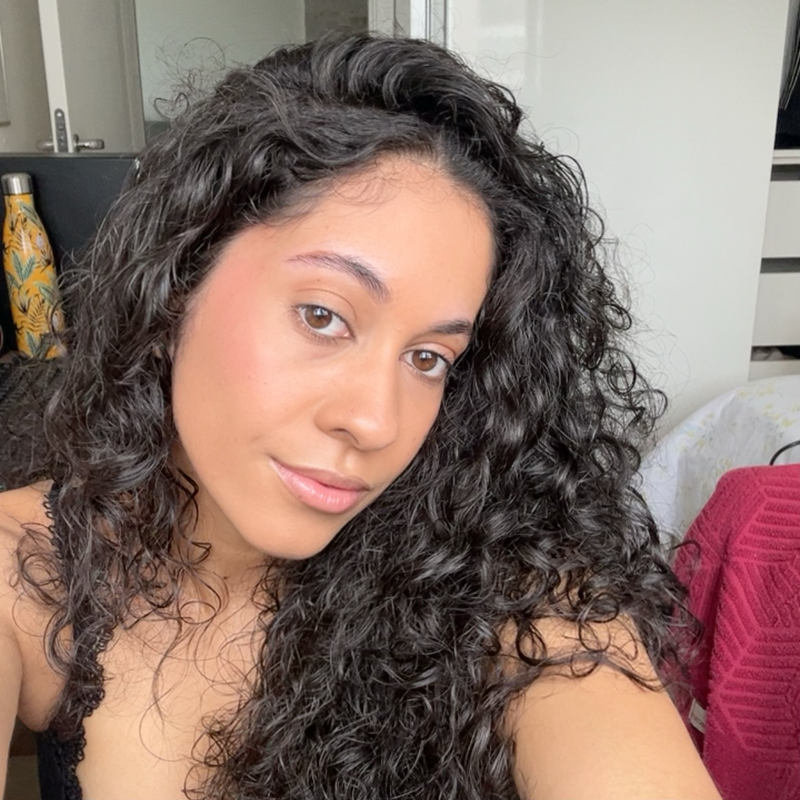
        <br />
        <strong>Beatriz Fernandes Silva</strong>
        <br />
        <a href="https://www.linkedin.com/in/beatrizfernandesilva/">LinkedIn</a> |
        <a href="https://github.com/olabeatrizfsilva">GitHub</a>
      </td>
      <td align="center">
        
        <br />
        <strong>Giovanna Alcard Souza Silva</strong>
        <br />
        <a href="https://www.linkedin.com/in/giovanna-alcard/">LinkedIn</a> |
        <a href="https://github.com/gialcard7-gif">GitHub</a>
      </td>
      <td align="center">
        
        <br />
        <strong>Guilherme Oliveira</strong>
        <br />
        <a href="https://www.linkedin.com/in/guilherme-oliveira-gomes-4b0735394/">LinkedIn</a> |
        <a href="https://github.com/guioliveirag">GitHub</a>
      </td>
    </tr>
    <tr>
      <td align="center">
        
        <br />
        <strong>Henrique Coelho</strong>
        <br />
        <a href="https://www.linkedin.com/in/henrique-fernandes-coelho-824665344/">LinkedIn</a> |
        <a href="https://github.com/henrique-fernandes-coelho1">GitHub</a>
      </td>
      <td align="center">
        
        <br />
        <strong>Larissa Andrade dos Santos</strong>
        <br />
        <a href="https://www.linkedin.com/in/larissaandradesant/">LinkedIn</a> |
        <a href="https://github.com/larissa-andrade-santos">GitHub</a>
      </td>
    </tr>
  </table>
</div>

## Imagens do projeto

### Página inicial

| Desktop | Tablet | Mobile |
|:---:|:---:|:---:|
| 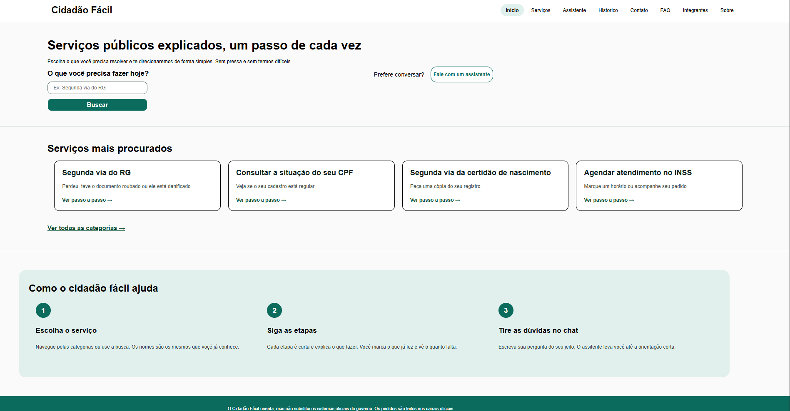 | 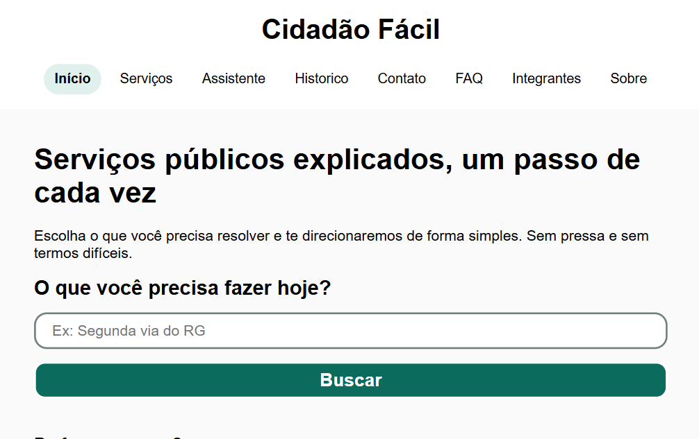 | 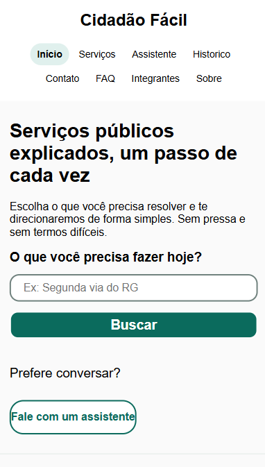 |

### Demais páginas

| Serviços | Assistente |
|:---:|:---:|
| 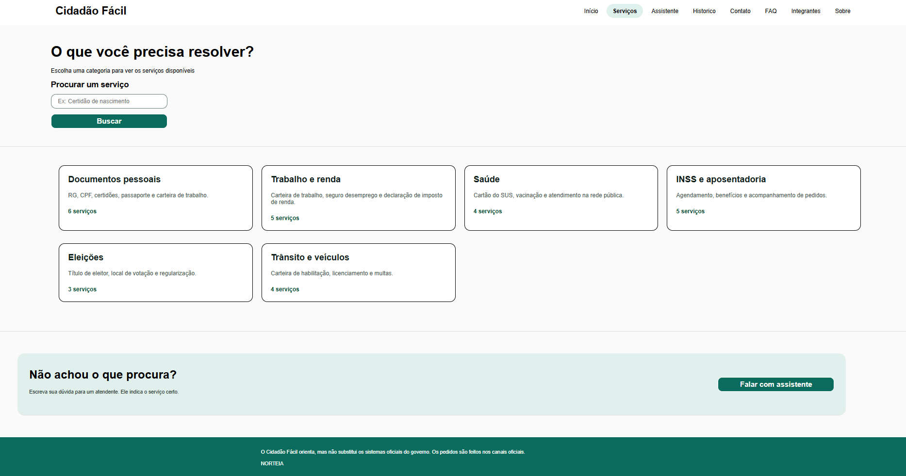 | 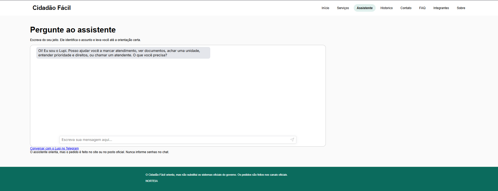 |

| Histórico | Contato |
|:---:|:---:|
| 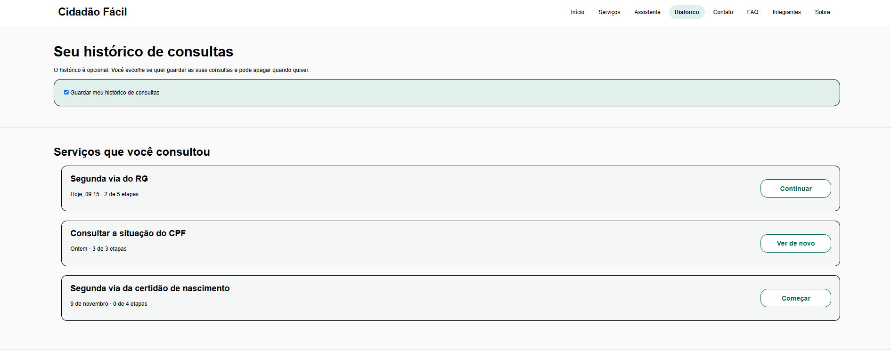 | 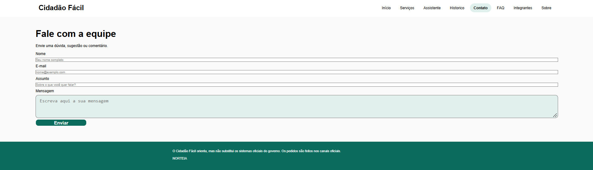 |

| FAQ | Integrantes |
|:---:|:---:|
| 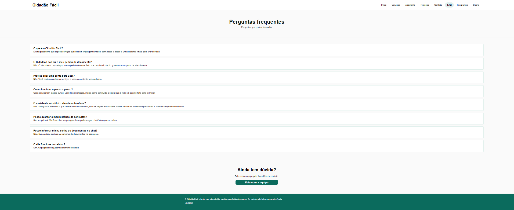 | 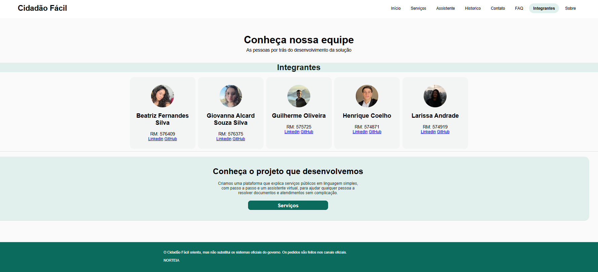 |

| Sobre |
|:---:|
| 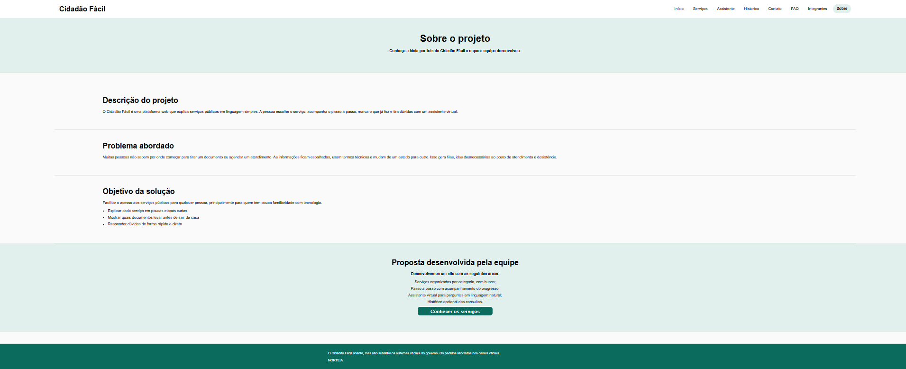 |
